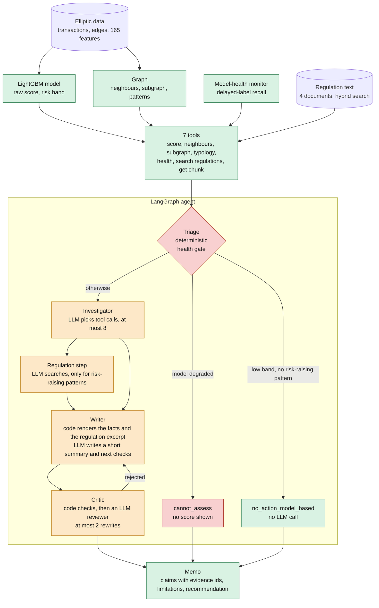

# TraceGuard

**Flags suspicious Bitcoin transactions with a gradient-boosting model, then has an LLM agent investigate each flag and draft a memo in which every claim cites evidence and is checked by a critic.** Built on the public Elliptic dataset, with pre-registered evaluations and the negative results left in.

[](https://github.com/iamrohitkumaryadav9/traceguard/actions/workflows/ci.yml)
&nbsp; **Live demo:** [traceguardfirstversionusingelliptical.streamlit.app](https://traceguardfirstversionusingelliptical.streamlit.app/)

The demo is the Streamlit Community Cloud deployment of [app/streamlit_app.py](app/streamlit_app.py). It reads the bundled [demo/memos.json](demo/memos.json) (30 pre-generated memos): no live model calls and no API key. Free-tier apps sleep when idle, so the first visit may show a "wake up" button.

**Try these first** (the five nodes on the app's Examples page):

| Transaction | Time step | What it shows |
|---|---|---|
| 73002538 | 42 | High-band node at time step 42: high raw score, verified memo with code-rendered facts. |
| 200950509 | 36 | Chain node: a risk-raising chain pattern but a low model score, so the memo states a signal conflict. |
| 114656654 | 38 | Fan-in node: the fan_in pattern lowers risk in the training data, so the model's low band stands (no action suggested). |
| 125406909 | 47 | Post-shutdown node (time step 47): the model-health check reports degradation, so the agent declines to assess. |
| 200638883 | 36 | Low-band node: no risk-raising pattern, so the memo suggests no action (model-based only) without any LLM call. |

## What it is, and what it is not

**It is** a small, end-to-end, inspectable system: a tabular model that scores transactions, seven tools that expose its output and the graph around a node, an agent that gathers evidence with those tools, and a memo whose claims each cite a piece of evidence that a critic then checks. It comes with measured limits: every evaluation was written down before it was run, and the ones that went against the design are reported as such.

**It is not** a novel idea: LLM-agent investigation systems with grounded reports and critics already exist, and this project makes no claim to have invented one. It does **not** claim that the agents improve detection; no experiment here measures that. It is not a compliance product, it does not decide whether a report should be filed, and its memos are drafts for a human analyst. The dataset has no wallet addresses, names, amounts or dates, so none can appear in a memo.

## Architecture



Green is code, orange involves an LLM, red is the health gate. Which parts are code and which are LLM-authored (design v3, tag `agent-v3.1`):

| Part | Written by |
|---|---|
| Score, risk band, thresholds, health status, neighbour and subgraph statistics, pattern matches, signal-conflict sentence | code (tools) |
| Activity description (the claims that restate the tool outputs) and the regulatory excerpt (verbatim, at most 40 words, or only a label for the OCR document) | code, rendered from the tool outputs by [src/agents/facts.py](src/agents/facts.py) |
| Which tools to call, which regulation query to run | LLM (investigator and regulation step; caps in [src/agents/config.py](src/agents/config.py): 8 tool calls, 3 searches, 2 rewrites, 30 LLM calls) |
| Executive summary (at most 3 sentences) and "what a human analyst could check next" | LLM, checked by the critic (next checks only for numbers and evidence ids) |
| Critic | deterministic checks (citations exist, numbers appear in the cited output, a risk-lowering pattern is never called suspicious, quotes are verbatim and from quotable chunks) plus an LLM reviewer |

The **health gate**: if the model-health check says the model has degraded at that time step, the run ends as `cannot_assess` with no score or band, before any LLM is called.

## Key results

Every number links to the file it comes from. Costs in the first two lines use an assumed cost ratio (a missed illicit node costs 10 false alerts); it is an assumption, not a measurement.

**The model**
- Before the shutdown (steps 35-42) the cost-based threshold costs 1,351 against 9,140 for flagging nothing; after it (steps 43-49) it costs 1,846 against 1,690 for flagging nothing, so it does not pay for itself there. [eval/results/phase2c.md](eval/results/phase2c.md)
- The model collapses after the dark-market shutdown: test recall 0.849 before and 0.018 after, PR-AUC 0.915 before and 0.039 after. [eval/results/phase2c.md](eval/results/phase2c.md)
- The delayed-label health monitor first flags the collapse at step 47 and raises no false alarm in steps 35-42; its constants were designed after the failure was seen, so this is not a blind test. [eval/results/model_health.md](eval/results/model_health.md)
- **Negative result:** the label-free drift monitor does not separate the periods. Score PSI is "major" in all 13 steps 30-42 and feature PSI in 12 of those 13 (false alarms); the alert-rate band flags none of steps 43-49. [eval/results/drift.md](eval/results/drift.md)
- Structural patterns are weak evidence: in steps 1-34 the chain flag has an illicit rate of 0.2573 against 0.1085 unflagged, while fan-in (0.0186) and fan-out (0.0000) are anti-informative, so they are treated as risk-lowering. [eval/results/typology_check.md](eval/results/typology_check.md)

**Regulation retrieval**
- On the 19 document-grounded golden questions the frozen setup (hybrid search with contextual headers, no rewriting, no reranker) has hit@3 0.579 and hit@1 0.316. Retrieval is weak; text it returns is a lead, not an authority. The reranker was rejected under a rule fixed in advance (hit@1 +0.045 against a required 0.10). [eval/results/retrieval_final.md](eval/results/retrieval_final.md)

**The agent evaluations** (all pre-registered: [5a spec](eval/agent_eval_spec.md), [5b spec](eval/agent_eval_5b_spec.md), [5c spec](eval/agent_eval_5c_spec.md))
- **5a, 40 cases:** citation and number consistency is 100% in every arm, so it cannot separate them; completeness is 79% for the ML-only arm and 96% with the agent; typology evidence with its direction appears in only 11 of 17 memos (65%) where a pattern matched; the critic changed 6 of the 27 runs that reached it. [eval/results/agent_eval/report.md](eval/results/agent_eval/report.md)
- **5b, hand-check and fault injection:** a human flagged 7 of 110 claims. The critic rejected 11 claims (the human agrees with 4) and missed 3 of the 7; the deterministic consistency metric caught 1 of the 7, so its 100% ceiling hid most real errors. By contrast the critic caught all 98 applicable synthetic faults and rejected 0 of 20 untampered controls: synthetic faults are easier than natural errors. [eval/results/agent_eval/report_5b.md](eval/results/agent_eval/report_5b.md)
- **5c, code-rendered facts, 30 fresh nodes:** **the pre-registered keep rule was not met** (completeness +0.031 against the required 0.05; completeness is near-tautological for v3 because code inserts the required items). Typology evidence with its direction appears in 5 of 8 v2 memos and 8 of 8 v3 memos; a neighbour summary in 17 of 21 and 21 of 21. Hand-check of v3: 0 of 20 code-built claims wrong, 1 of 61 LLM-written summary sentences overstated. The service uses v3 as a judgement made after the results, not as a test outcome. [eval/results/agent_eval_5c/report_5c.md](eval/results/agent_eval_5c/report_5c.md)
- **5c critic diagnosis and bugfix:** v3's critic rejected more (21 items, mostly too strict) than v2's (10, mostly genuine LLM errors); a next-check rule that rejected any digit was fixed (tag `agent-v3.1`), and on the 8 diagnosis nodes rejected items fell from 21 to 10. Those nodes were used for the diagnosis, so no generalisation is claimed. [diagnosis](eval/results/agent_eval_5c/rejection_diagnosis.md), [bugfix report](eval/results/agent_eval_5c_bugfix/bugfix_report.md)

The per-phase design notes, commit hashes and caveats are in [docs/PHASE_NOTES.md](docs/PHASE_NOTES.md).

## Setup

**Prerequisites.** Python 3.14 (the version in [the CI workflow](.github/workflows/ci.yml)), git, a Kaggle account for the dataset, and for live mode and the evaluations a Gemini API key (free tier; the model is set in [src/agents/config.py](src/agents/config.py)). Docker is optional.

```
py -3.14 -m venv .venv            # Linux/macOS: python3.14 -m venv .venv
.venv\Scripts\activate            # Linux/macOS: source .venv/bin/activate
pip install -r requirements.txt
```

Use Python 3.14 explicitly: a newer default interpreter (3.15 was tried) fails at install because `faiss-cpu` has no wheel for it. On a clean clone this installs, and `pytest` passes, with no data, key or `.env`.

**Tests** need no data, key or network (the agent tests use a scripted fake LLM): `pytest`.

**Data (needed for live mode and for retraining, not for tests or the demo).**
1. Download the Elliptic dataset from Kaggle (`kaggle datasets download -d ellipticco/elliptic-data-set`, or the web page) and put the three files `elliptic_txs_features.csv`, `elliptic_txs_classes.csv` and `elliptic_txs_edgelist.csv` in `data/raw/`.
2. `python -m src.split` writes `data/processed/nodes.parquet` and `edges.parquet`.
3. Regulation PDFs go in `data/raw/regulations/` under the file names in [src/rag/SOURCES.md](src/rag/SOURCES.md); then `python -m src.rag.ocr` (the India document is a scan) and `python -m src.rag.ingest`.
4. Train the model and the artefacts the tools read (`models/`, `eval/results/threshold.json`): `python -m src.ml.graph_features`, then `python -m src.ml.phase2b --final "LightGBM (165 original)" --md phase2c.md --title "Phase 2c results (final model: 165 original features)" --tag _2c`. This overwrites `models/`, `eval/results/threshold.json`, `eval/results/phase2c.md` and the `_2c` figures. The flags were checked against `--help`; the command itself was not re-run. The `data/` and `models/` folders are not in the repository.

**API key.** Copy `.env.example` to `.env` and set `GEMINI_API_KEY`. The key is read at run time with python-dotenv and never printed; `.env` is gitignored.

**One investigation from the command line:** `python -m src.agents.run <tx_id>`.

**API** ([src/api/main.py](src/api/main.py); endpoints `GET /health`, `POST /investigate`, `GET /memo/{tx_id}`, `GET /examples`, `GET /memos`; docs at `/docs`).
- *Demo mode* (default, no data, model or key): `pip install -r requirements-api.txt`, then `TRACEGUARD_MODE=demo uvicorn src.api.main:app --port 8000` (PowerShell: `$env:TRACEGUARD_MODE="demo"; uvicorn src.api.main:app --port 8000`). It serves only the pre-computed memos in `demo/memos.json` and cannot run the agent.
- *Live mode*: `TRACEGUARD_MODE=live uvicorn src.api.main:app --port 8000` (PowerShell: set `$env:TRACEGUARD_MODE="live"` first; not run in the fresh-clone check, which had no data or key). Guardrails, set by environment variable ([src/api/settings.py](src/api/settings.py)): 6 live runs per client IP per hour, a global budget of 400 LLM calls per day, a 240 s request timeout, one run at a time, provider quota errors as HTTP 503 with `Retry-After`.

**Streamlit app** ([app/streamlit_app.py](app/streamlit_app.py)): `pip install -r requirements-demo.txt` (streamlit only; enough on its own), then `streamlit run app/streamlit_app.py` (add `--server.headless true` on a server). It reads `demo/memos.json` directly; set `API_URL` to use the API instead. Deployment to Streamlit Community Cloud or a Hugging Face Space (demo mode) is described in [docs/PHASE_NOTES.md](docs/PHASE_NOTES.md#phase-6b-streamlit-ui).

**Docker** ([Dockerfile](Dockerfile), [docker-compose.yml](docker-compose.yml)): `docker compose --profile demo up --build` (small image, no data) or `docker compose --profile live up --build` (mounts `./data` and `./models` read-only; needs `.env`). These images have not been built or run in the environment this was written in.

**Rebuild the demo bundle:** `python -m scripts.build_demo_bundle` (prints the included fields and a ground-truth-label check).

## Repository map

| Path | What is there |
|---|---|
| `src/data.py`, `src/split.py` | loading Elliptic, the temporal split (fit 1-29, validation 30-34, test 35-49) |
| `src/ml/` | baselines, final model pipeline, cost threshold, calibration, SHAP, drift monitor, graph features |
| `src/tools/` | the 7 agent tools with Pydantic schemas and the shared context |
| `src/rag/` | regulation ingest, OCR, hybrid retrieval, matching; [SOURCES.md](src/rag/SOURCES.md) |
| `src/agents/` | LangGraph agent: triage, investigator, regulation, writer, critic; code-rendered facts ([facts.py](src/agents/facts.py)); memo schema |
| `src/api/` | FastAPI service, demo bundle reader, rate limit and budget |
| `src/ui/`, `app/` | Streamlit render logic and page code |
| `demo/memos.json` | pre-computed memos for demo mode |
| `eval/` | evaluation code and specs (`agent_eval*_spec.md`), runners (`run_*.py`), results under `eval/results/` |
| `tests/` | the unit tests (fake LLM, no network) |
| `scripts/` | EDA and the demo-bundle builder |
| `docs/PHASE_NOTES.md` | per-phase notes, pre-registered rules and caveats |
| `notebooks/figures/` | figures used in the reports and the app |

## Limitations and honest notes

- **Elliptic has no sanctions data, addresses, names, amounts or dates**, and no typology labels; patterns are structural resemblances only.
- **The model fails after the dark-market shutdown** (steps 43-49), and the health monitor only notices at step 47. The monitor's constants were designed after seeing the failure, and the final model was chosen citing test numbers, so the test period is not a pure holdout for those choices.
- **Scores are raw gradient-boosting outputs**, not calibrated probabilities; the cost ratio behind the alert threshold is an assumption.
- **One LLM** (`gemini-3.5-flash-lite`) acts as investigator, writer and reviewer; the reviewer is sometimes too strict or wrong, and a model judging its own family's output is not independent.
- **Evaluations are small**: 40, 30 and 8 nodes and about 110 hand-checked claims, one human reader, so every rate has a wide interval. The hand-check rates of 5b and 5c are not comparable (different sets, different designs), and no claim is made that v3 is more accurate than v2.
- **The 5c decision to use v3** was made after seeing the results; the pre-registered rule was not met. The bugfix verification used nodes that had informed the diagnosis.
- **Retrieval is weak** (hit@3 0.579 on a small golden set); the India guidelines are OCR text and are never quoted.
- **The "what a human analyst could check next" suggestions are unconstrained LLM text** and may not be actionable with this dataset.
- **The demo bundle** contains generated memos with transaction ids, scores, neighbour ids and aggregate statistics, not the dataset files; no SHAP feature values and no labels.
- This is a draft generator for a human analyst. Nothing here measures that the agents improve detection.

## Data source

This project uses the Elliptic Bitcoin dataset from Kaggle, published by Elliptic and described in Weber et al. (2019), "Anti-Money Laundering in Bitcoin: Experimenting with Graph Convolutional Networks for Financial Forensics", [arXiv:1908.02591](https://arxiv.org/abs/1908.02591). The dataset is released under CC BY-NC-ND 4.0. This is non-commercial portfolio work. The raw data files are not included in this repository; download them from Kaggle and place them as described in the setup steps above. The demo bundle (`demo/memos.json`) contains only generated memos with transaction ids, scores and aggregate statistics, not the dataset files.

## Reproducing the evaluation

All commands run from the repository root with the data, models and `.env` in place. They write under `eval/results/` and are resumable.

| Experiment | Command |
|---|---|
| Phase 2a baselines | `python -m src.ml.baselines` |
| Final model, cost threshold, calibration | `python -m src.ml.phase2b --final "LightGBM (165 original)" --md phase2c.md --title "Phase 2c results (final model: 165 original features)" --tag _2c` (needs `python -m src.ml.graph_features` first) |
| Drift monitor and health monitor | `python -m src.ml.drift`, `python -m eval.health_eval` |
| Typology check | `python -m eval.typology_check` |
| Retrieval | `python -m eval.retrieval_eval`, `python -m eval.retrieval_final` |
| 5a agent evaluation (40 cases) | `python -m eval.run_agent_eval` (`--report-only` / `--rescore` use saved results, no LLM) |
| 5b judge, fault injection, hand-check sheet, report | `python -m eval.run_5b all` |
| 5c v2 versus v3 (30 fresh nodes) | `python -m eval.run_agent_eval_5c` (v2 runs from a `git worktree` of tag `agent-v2`, created automatically) |
| 5c hand-check sheet and scoring | `python -m eval.agent_eval_5c.handcheck_5c build`, fill `human_verdict` in `eval/results/agent_eval_5c/handcheck_5c.csv`, then `... score` |
| 5c bugfix verification (8 nodes) | `python -m eval.run_5c_bugfix` |

**Free-tier quota.** The free tier allows 500 requests per day per model ([spec](eval/agent_eval_5c_spec.md)), and a full 5c run may take two days. The runners record a quota error, stop cleanly and resume where they stopped on the next invocation; they never retry a daily quota error in a loop. Tests never touch the network.
